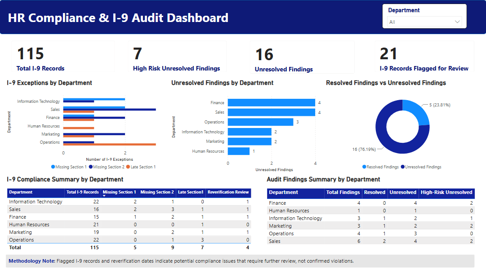

# HR Compliance & I-9 Audit | SQL & Power BI

## Overview

I built this project to get more hands-on experience using SQL and Power BI for HR compliance reporting.

I started with synthetic employee, I-9, and audit findings data, created a relational database in PostgreSQL, and used SQL views to identify potential compliance exceptions. I then built a Power BI dashboard to review I-9 records, track audit findings, and highlight areas that may need further attention.

The goal was to explore how HR compliance data can be organized and used to make audit reviews easier.

## Dashboard

## Tools Used

- **PostgreSQL / SQL** – Database design, data relationships, joins, views, and compliance analysis
- **Power BI** – Dashboard development, KPI cards, slicers, and data visualization
- **VS Code** – SQL scripts and project documentation

## What I Did

**1. Created the database**

I created three related tables to organize the data:

- `employees` – Employee details, department, location, and employment status
- `i9_records` – I-9 completion dates and reverification due dates
- `audit_findings` – Finding types, risk levels, and resolution status

I used primary keys and foreign keys to connect employee records with their corresponding I-9 records and audit findings.

**2. Developed SQL views**

I created three SQL views to summarize the data:

- I-9 exceptions by department
- Resolved and unresolved audit findings by department
- Flagged I-9 records by department

The queries use JOINs, conditional aggregation, COUNT DISTINCT, and date comparisons to identify potential exceptions.

**3. Built the Power BI dashboard**

I used the SQL views to build an interactive dashboard featuring:

- Total I-9 records and flagged records
- High-risk and unresolved audit findings
- Missing Section 1 and Section 2 dates
- Potentially late Section 1 completions
- Resolved versus unresolved findings

I also added a department filter to make it easier to review compliance findings across different departments.

## Key Findings

| Metric | Result |
|---|---:|
| Total I-9 Records | 115 |
| I-9 Records Flagged | 21 |
| Missing Section 1 Dates | 5 |
| Missing Section 2 Dates | 9 |
| Potentially Late Section 1 | 7 |
| Resolved Findings | 5 |
| Unresolved Findings | 16 |
| High-Risk Unresolved Findings | 7 |

The analysis identified 21 I-9 records with at least one potential exception. It also showed that 16 audit findings remained unresolved, including 7 classified as high risk.

Exception categories may overlap, since an individual I-9 record can have more than one issue.

## Project Files

### SQL Scripts

| File | Description |
|---|---|
| `01_create_employees.sql` | Employee table creation |
| `02_create_i9_records.sql` | I-9 records table creation |
| `03_create_audit_findings.sql` | Audit findings table creation |
| `04_vw_i9_department_audit.sql` | Department-level I-9 audit view |
| `05_vw_audit_findings_summary.sql` | Audit findings summary view |
| `06_vw_i9_flagged_by_department.sql` | Flagged I-9 records by department |

### Data & Dashboard

| File | Description |
|---|---|
| `employees.csv` | Synthetic employee dataset |
| `i9_records.csv` | Synthetic I-9 records |
| `audit_findings.csv` | Synthetic audit findings |
| `HR Compliance & I-9 Audit Dashboard.pbix` | Power BI report |
| `hr_compliance_dashboard.png` | Dashboard screenshot |

## Notes & Limitations

- All employee and audit data is synthetic and does not represent an actual organization.
- Missing dates and overdue indicators represent potential exceptions requiring further review, not confirmed compliance violations.
- High-risk classifications are based on predefined values in the synthetic dataset.
- Reverification requirements must be evaluated against the underlying employment authorization documentation and applicable regulations.
- The project is intended to demonstrate SQL and Power BI skills in an HR compliance reporting context.

## Skills Demonstrated

**SQL Data Analysis | PostgreSQL | Database Design | SQL Views | HR Compliance | I-9 Auditing | Data Quality Monitoring | Power BI | Data Visualization**